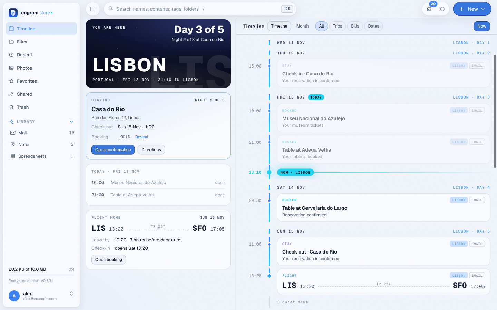
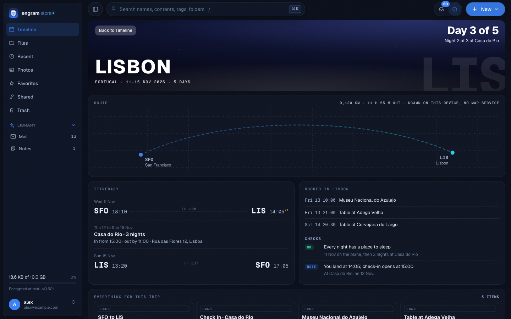
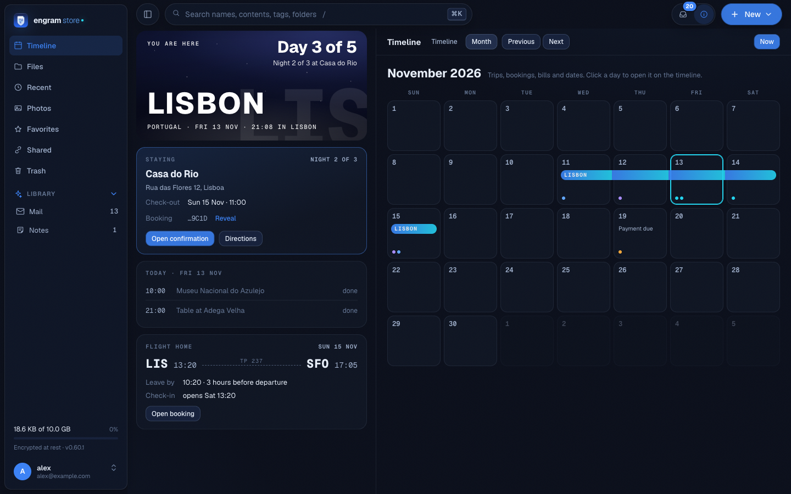
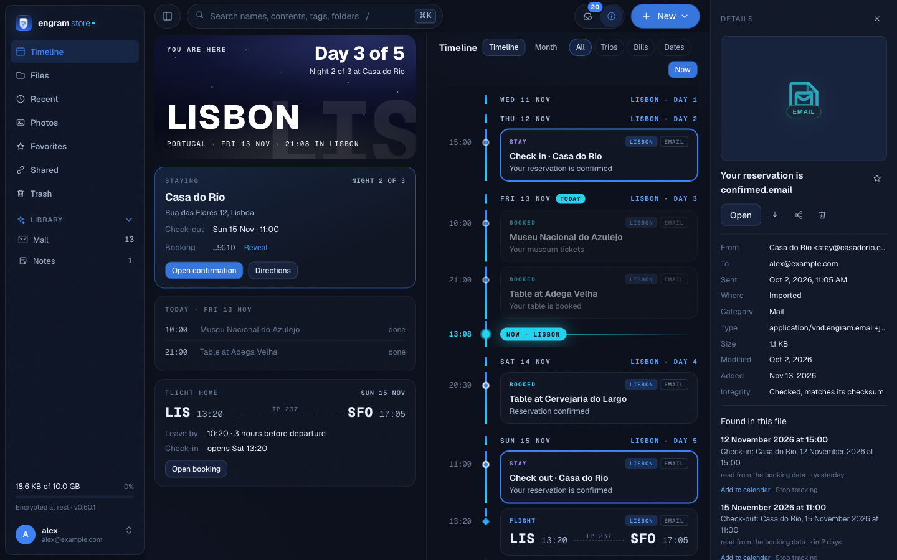
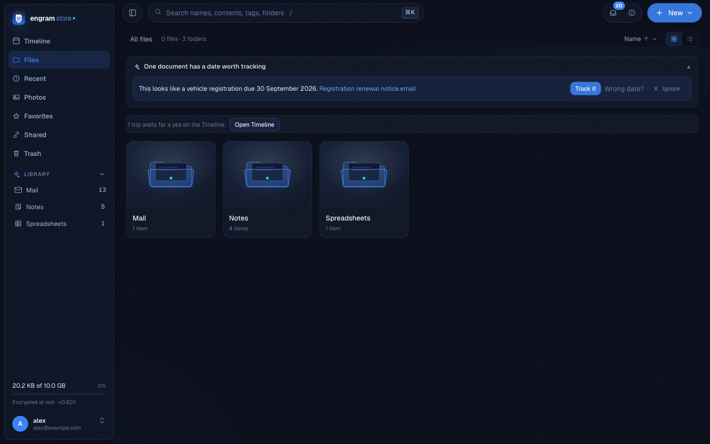
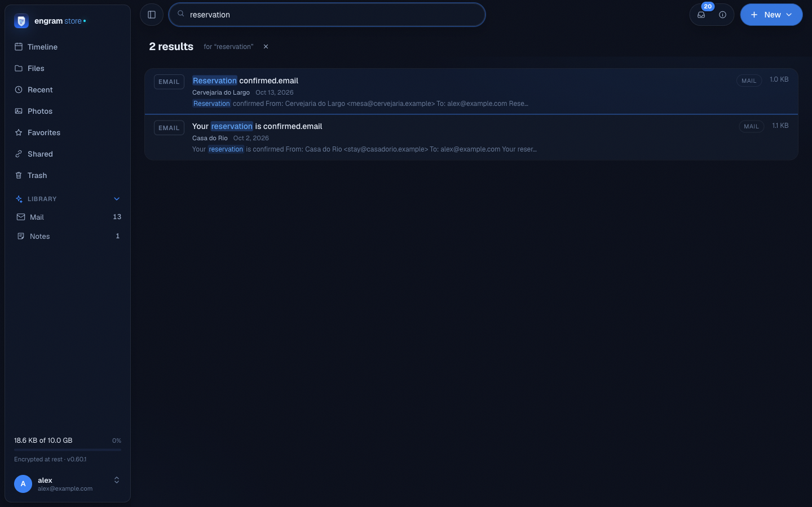
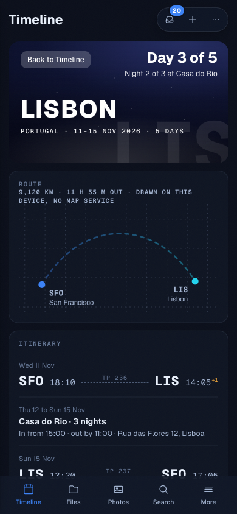
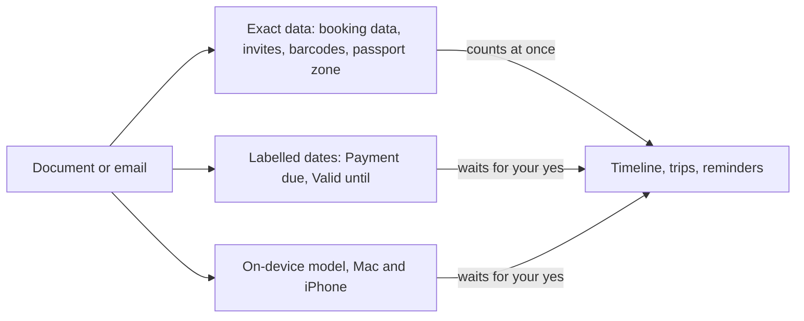

# Engram Store

**Self-hostable cloud storage that is end-to-end encrypted, and still smart.**

[](https://github.com/harsharahul/engramer-store/actions/workflows/ci.yml)
[](https://github.com/harsharahul/engramer-store/releases/latest)
[](https://github.com/harsharahul/engramer-store/releases)
[](https://github.com/harsharahul/engramer-store/pkgs/container/engramer-store)
[](package.json)
[](LICENSE)

Files, names, folders, tags and search text are encrypted on your device before upload. The server stores ciphertext it cannot read. Search, previews, document reading and the Timeline all run on the device, so the vault stays useful without anyone else seeing what is in it.

<picture>
  <source media="(prefers-color-scheme: dark)" srcset="docs/media/timeline-dark.png">
  
</picture>

## What it looks like

<table>
  <tr>
    <td width="50%" valign="top">
      
      <br><b>Trips come together on their own.</b> Flights, stays and tickets found in your mail and documents become one trip: the itinerary, what to check, the cost bill by bill, and every document in it.
    </td>
    <td width="50%" valign="top">
      
      <br><b>One place for time.</b> Bills, bookings, deliveries, renewals and photo days in order, with a Month view. The app opens on what is happening now and what is next.
    </td>
  </tr>
  <tr>
    <td width="50%" valign="top">
      
      <br><b>Mail as part of the vault.</b> Import <code>.eml</code> and <code>.mbox</code> exports. Each email and each real attachment becomes an encrypted file. Every reading says where it came from: here, a check-in and a check-out read from the booking data.
    </td>
    <td width="50%" valign="top">
      
      <br><b>Filed for you, never assumed.</b> Uploads are sorted by kind and tagged on the device. A date found in a document is offered once (Track it, Wrong date, Ignore), and nothing is tracked until you say so.
    </td>
  </tr>
  <tr>
    <td width="50%" valign="top">
      
      <br><b>Search that finds what you half remember.</b> Names, tags, folders and the text inside documents, PDFs, scans and mail, with filters such as <code>type:email</code>, <code>from:</code>, <code>tag:receipts</code> and <code>before:2026</code>. Queries never leave the device.
    </td>
    <td width="50%" valign="top" align="center">
      
      <br><b>The same vault on your phone.</b> The iPhone app adds the vault to Files, the share sheet and photo backup. The web client works in any mobile browser.
    </td>
  </tr>
</table>

## How it stays private

```
         YOUR DEVICE                     SERVER                    STORAGE
+---------------------------+     +------------------+     +----------------------+
| reads:    text, OCR,      |     | holds ciphertext |     | local disk, S3, or   |
|           dates, trips,   | --> | it cannot read   | --> | cloud storage you    |
|           search index    | <-- |                  |     | already pay for      |
| encrypts: content, names, |     +------------------+     +----------------------+
|           tags, index     |              |
+---------------------------+              |  ciphertext only
                                           v
                                  YOUR OTHER DEVICES
                                  decrypt with your keys
```

| The server stores | The server can never see |
|---|---|
| Ciphertext blobs, wrapped keys, KDF parameters, a one-way digest of the login key, blob sizes, timestamps, the shape of the folder tree | File contents, file and folder names, thumbnails, search text, dates read from documents, your password, any decryption key |

This holds even if the server is fully compromised. The design is in [docs/architecture.md](docs/architecture.md), the threat model in [SECURITY.md](SECURITY.md).

## How a date reaches the Timeline



Every reader runs on the device. A value that the document does not state cannot be stored, and nothing is sent to a model in the cloud. Details and measured accuracy are in [docs/intelligence.md](docs/intelligence.md).

## Features

| Area | What you get | More |
|---|---|---|
| **Encryption** | XChaCha20-Poly1305 for content, XSalsa20-Poly1305 for keys and metadata, Argon2id for the password. libsodium only, no custom cryptography. A digest taken before encryption proves that what comes back is what you stored. | [architecture](docs/architecture.md) |
| **Accounts** | Recovery key, TOTP two-factor, unlock with Touch ID, Face ID or a passkey, sign out everywhere, delete your own account. | [auth](docs/auth.md) |
| **Files** | Folders, drag-and-drop upload of whole folder trees, version history on every file, trash and restore, quotas. Uploads are filed by kind and tagged on the device. | [storage](docs/storage.md) |
| **Timeline and trips** | Dates, amounts and bookings read from documents and mail. Trips assembled from exact evidence, with a page per trip, checks such as passport validity, spend per currency and calendar export. | [intelligence](docs/intelligence.md) |
| **Mail** | Import saved messages and mailbox exports, including Google Takeout and Apple Mail. A safe viewer with remote images off until asked. | [intelligence](docs/intelligence.md) |
| **Search** | One engine for names (typo tolerant), tags, folder paths and full text. Opt-in OCR and search by meaning ("a dog on a beach"). On the Mac and iPhone apps: search in plain words, one-line summaries and Ask your files, all on the device. | [intelligence](docs/intelligence.md) |
| **Photos and media** | A photo timeline, albums stored as encrypted tags, encrypted thumbnails, and video that starts at once and seeks anywhere while every chunk is verified. | [storage](docs/storage.md) |
| **Documents** | Previews for PDF, Word, spreadsheets, images and text. PDFs can be searched, marked up, filled and re-paged. Word and Excel files are edited in the browser in their own format, and two people can edit at once. | [office editing](docs/office-editing.md), [collaboration](docs/collaboration.md) |
| **Sharing** | Links that carry the key in the URL fragment, with password, expiry and download limits. Sharing to another account as viewer or editor. File requests that let anyone send files into your vault. | [sharing](docs/sharing.md) |
| **Apps** | A Mac app with a Finder drive and watch folders. An iPhone app with the vault in Files, the share sheet and photo backup. An installable web app. The Mac and iPhone apps can also keep the vault on the device, with no server. | [native apps](docs/native-apps.md) |
| **Self-hosting** | One container. SQLite or PostgreSQL. Blobs on local disk, S3, or a provider you already pay for through rclone. Storage tiering on ciphertext, registration policy, an admin panel, and a local S3 bridge for rclone and other S3 tools. | [backends](docs/backends.md), [S3 gateway](docs/s3-gateway.md) |

## Quickstart

### Docker

```bash
docker run -d --name engramer -p 3080:3080 -v engramer-data:/data \
  ghcr.io/harsharahul/engramer-store:latest
```

Open http://127.0.0.1:3080, create a vault, and keep the recovery key somewhere safe. With Compose: `docker compose up -d` (see [compose.yml](compose.yml)). All state lives in the `/data` volume.

### On cloud storage you already pay for

```bash
cp .env.example .env       # paste your provider token; the file explains each line
docker compose -f compose.rclone.yml --profile drime up -d
```

Drime and pCloud have ready profiles; every other provider rclone reaches works through the `custom` profile. Providers with an S3 API (FileLu S5, MinIO, Cloudflare R2) need no gateway: set `ENGRAMER_S3_*`. The provider only ever holds encrypted blobs under meaningless names. Recipes are in [docs/backends.md](docs/backends.md).

### From source

Requirements: Node.js 22+ and pnpm.

```bash
pnpm install
pnpm --filter @engramer/web build
pnpm --filter @engramer/server start
```

### Apps

- **Mac:** a notarized DMG on the [releases page](https://github.com/harsharahul/engramer-store/releases). It asks for your server on first launch, or keeps the vault on the Mac.
- **iPhone:** a native app, distributed through TestFlight, with the same choice on its sign-in screen: your server, or a vault on the phone. See [docs/native-apps.md](docs/native-apps.md).
- **Any browser:** the web client installs as an app (Safari: Add to Dock or Add to Home Screen; Chrome: Install).

### With an AI agent

Point an agent that can run shell commands at [skills/setup/SKILL.md](skills/setup/SKILL.md). It asks what kind of deployment you want, sets it up, and checks the result.

## Configuration

Run it behind TLS in production: the login key must only travel over HTTPS.

<details>
<summary>Environment variables</summary>

| Variable | Default | Purpose |
|---|---|---|
| `ENGRAMER_PORT` | `3080` | Listen port |
| `ENGRAMER_HOST` | `127.0.0.1` | Bind address |
| `ENGRAMER_DATA_DIR` | `data` | SQLite database and blob storage location |
| `ENGRAMER_QUOTA_BYTES` | `10737418240` | Per-user storage quota (10 GB) |
| `ENGRAMER_MAX_BLOB_BYTES` | `21474836480` | Hard cap for a single upload |
| `ENGRAMER_WEB_DIST` | auto-detected | Path to a built web client to serve |
| `ENGRAMER_S3_BUCKET` | unset | Store blobs in an S3-compatible bucket instead of local disk |
| `ENGRAMER_DERIVED_BACKEND` | unset | `fs` keeps thumbnails and search indexes on local disk while content lives on a remote store (single instance only) |
| `ENGRAMER_CONTENT_CACHE_MAX_BYTES` | unset | Cache content blobs at or under this size on local disk, so repeat document opens are instant |
| `ENGRAMER_PUBLIC_ORIGINS` | unset | Origins browsers reach this server on, when a proxy rewrites the Host header (Word and Excel editing needs this) |
| `ENGRAMER_DATABASE_URL` | unset | PostgreSQL connection string; replaces SQLite for replicated deployments |
| `ENGRAMER_DATABASE_LISTEN_URL` | `ENGRAMER_DATABASE_URL` | Direct connection to the PostgreSQL primary for the change bus, when the pool goes through a pooler |
| `ENGRAMER_JWT_SECRET` | generated | Session-signing secret; required with `ENGRAMER_DATABASE_URL`, shared by every instance |
| `ENGRAMER_CHANNEL_RECHECK_MS` | `60000` | How often a live document socket re-checks that its account still has access |
| `ENGRAMER_DRAIN_DEADLINE_MS` | `40000` | How long a stopping instance waits for requests and streams before closing what is left |
| `ENGRAMER_REGISTRATION` | `open` | `open`, `invite`, or `closed` |
| `ENGRAMER_ADMIN_EMAILS` | unset | Comma-separated admin accounts; enables the inline admin panel |
| `ENGRAMER_MAX_VERSIONS` | `10` | Versions kept per file; `0` disables history |
| `ENGRAMER_COLLAB_RELAY` | `on` | `off` disables live co-editing; documents stay editable one person at a time |
| `ENGRAMER_EVENTS` | `on` | `off` disables the change feed; always-on clients fall back to their sync cycle |
| `ENGRAMER_TRUSTED_PROXIES` | unset | Hop count or address allowlist for forwarded headers behind a proxy |
| `ENGRAMER_CORS_ORIGINS` | unset | Extra origins allowed to call the API |
| `ENGRAMER_HSTS` | `off` | `on` sends `Strict-Transport-Security` on HTTPS responses, for deployments whose proxy does not |
| `ENGRAMER_MAC_DMG_URL` | unset | Where this deployment hosts the Mac app DMG; adds a "Get the Mac app" row to Profile |

</details>

Storage tiering, caches and request budgets are covered in [docs/storage.md](docs/storage.md) and [docs/backends.md](docs/backends.md). There is no password reset: the server never holds key material, so the recovery key is the only way back in.

## Development

```bash
pnpm --filter @engramer/server dev   # API server with reload, port 3080
pnpm --filter @engramer/web dev      # Vite dev server, port 5173, proxies /api
pnpm test                            # crypto, web and server suites
pnpm build                           # typecheck and build everything
docker build -t engramer-store .     # container image
```

```
packages/crypto/   E2EE core: key hierarchy, streaming encryption, sealed boxes
apps/server/       Zero-knowledge API: Fastify, SQLite or PostgreSQL, pluggable blob stores
apps/web/          Web client: React, all crypto in the browser
apps/desktop/      Tauri 2 shell for the Mac and iPhone apps, with the Files and Finder extensions
apps/bridge/       Local zero-knowledge S3 endpoint over the vault
crates/            Rust crypto core and on-device backend for the Apple targets
```

The integration tests drive the real API with the real crypto package, including a check that blobs on disk hold no plaintext. CI runs the suites on Node 22 and 24, audits production dependencies and smoke-tests the container image on every pull request. The principles every change is held to are in [docs/principles.md](docs/principles.md), and where each control belongs is in [docs/information-architecture.md](docs/information-architecture.md).

## Security

See [SECURITY.md](SECURITY.md) for the threat model and how to report vulnerabilities.

## License

[AGPL-3.0-only](LICENSE).
