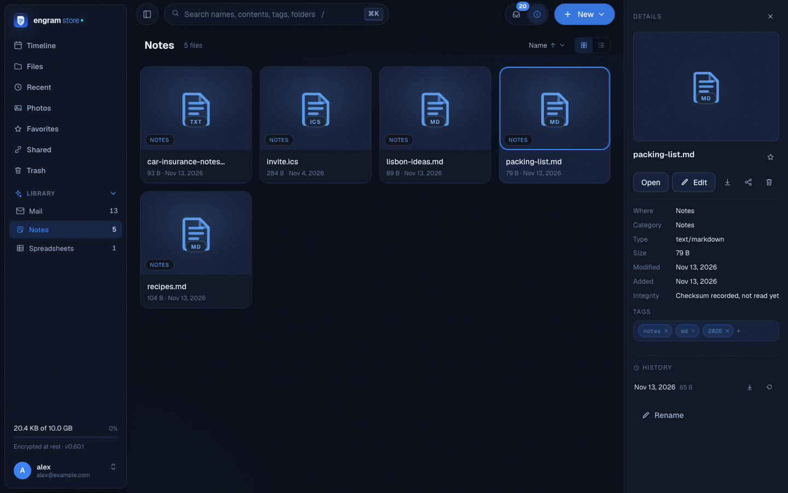
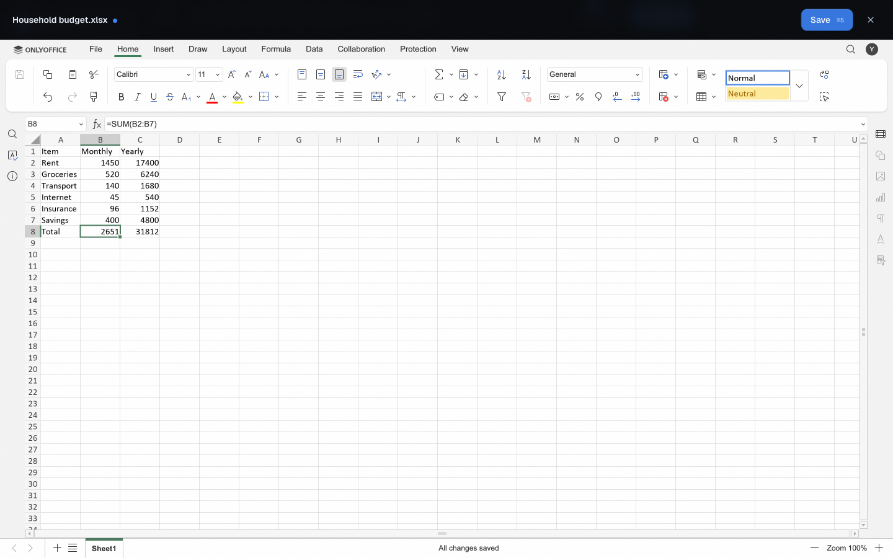
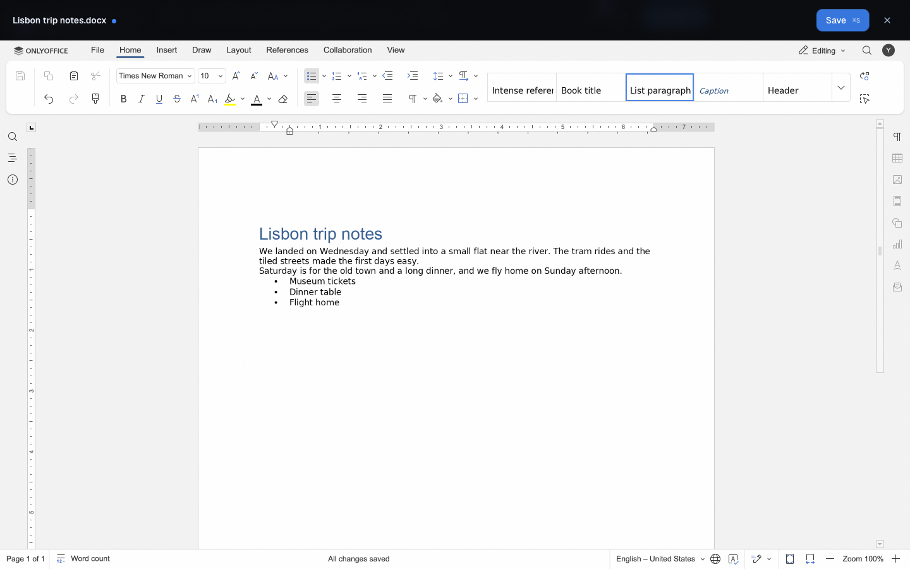
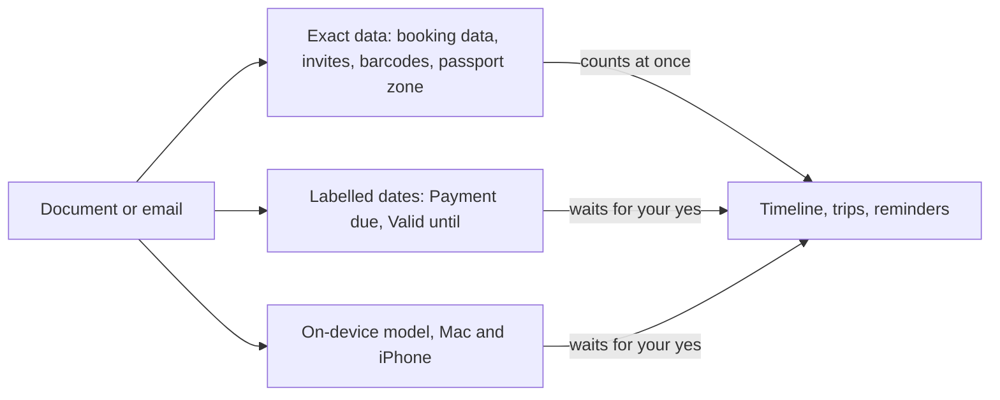

# Engram Store

**Self-hostable cloud storage that is end-to-end encrypted, and still smart.**

[](https://github.com/harsharahul/engramer-store/actions/workflows/ci.yml)
[](https://github.com/harsharahul/engramer-store/releases/latest)
[](https://github.com/harsharahul/engramer-store/releases)
[](https://github.com/harsharahul/engramer-store/pkgs/container/engramer-store)
[](package.json)
[](LICENSE)

Files, names, folders, tags and search text are encrypted on your device before upload. The server stores ciphertext it cannot read. Search, previews, document reading and the Timeline all run on the device, so the vault stays useful without anyone else seeing what is in it.

<picture>
  <source media="(prefers-color-scheme: dark)" srcset="docs/media/timeline-dark.png">
  
</picture>

## What it looks like

<table>
  <tr>
    <td width="50%" valign="top">
      
      <br><b>Trips come together on their own.</b> Flights, stays and tickets found in your mail and documents become one trip: the itinerary, what to check, the cost bill by bill, and every document in it.
    </td>
    <td width="50%" valign="top">
      
      <br><b>One place for time.</b> Bills, bookings, deliveries, renewals and photo days in order, with a Month view. The app opens on what is happening now and what is next.
    </td>
  </tr>
  <tr>
    <td width="50%" valign="top">
      
      <br><b>Mail as part of the vault.</b> Import <code>.eml</code> and <code>.mbox</code> exports. Each email and each real attachment becomes an encrypted file. Every reading says where it came from: here, a check-in and a check-out read from the booking data.
    </td>
    <td width="50%" valign="top">
      
      <br><b>Filed for you, never assumed.</b> Uploads are sorted by kind and tagged on the device. A date found in a document is offered once (Track it, Wrong date, Ignore), and nothing is tracked until you say so.
    </td>
  </tr>
  <tr>
    <td width="50%" valign="top">
      
      <br><b>Search that finds what you half remember.</b> Names, tags, folders and the text inside documents, PDFs, scans and mail, with filters such as <code>type:email</code>, <code>from:</code>, <code>tag:receipts</code> and <code>before:2026</code>. Queries never leave the device.
    </td>
    <td width="50%" valign="top" align="center">
      
      <br><b>The same vault on your phone.</b> The iPhone app adds the vault to Files, the share sheet and photo backup. The web client works in any mobile browser.
    </td>
  </tr>
</table>

## How it stays private

```
         YOUR DEVICE                     SERVER                    STORAGE
+---------------------------+     +------------------+     +----------------------+
| reads:    text, OCR,      |     | holds ciphertext |     | local disk, S3, or   |
|           dates, trips,   | --> | it cannot read   | --> | cloud storage you    |
|           search index    | <-- |                  |     | already pay for      |
| encrypts: content, names, |     +------------------+     +----------------------+
|           tags, index     |              |
+---------------------------+              |  ciphertext only
                                           v
                                  YOUR OTHER DEVICES
                                  decrypt with your keys
```

| The server stores | The server can never see |
|---|---|
| Ciphertext blobs, wrapped keys, KDF parameters, a one-way digest of the login key, blob sizes, timestamps, the shape of the folder tree | File contents, file and folder names, thumbnails, search text, dates read from documents, your password, any decryption key |

This holds even if the server is fully compromised. The design is in [docs/architecture.md](docs/architecture.md), the threat model in [SECURITY.md](SECURITY.md).

## Features

Everything below runs on your device or on ciphertext. Each group ends with the document that explains it in depth.

| | | | | |
|---|---|---|---|---|
| [Security and accounts](#security-and-accounts) | [Files](#files) | [Documents: Word, Excel, PDF and notes](#documents-word-excel-pdf-and-notes) | [Timeline, dates and trips](#timeline-dates-and-trips) | [Mail](#mail) |
| [Search and understanding](#search-and-understanding) | [Photos and media](#photos-and-media) | [Sharing](#sharing) | [Apps and devices](#apps-and-devices) | [Self-hosting and storage](#self-hosting-and-storage) |

### Security and accounts

- **End-to-end encryption.** File content is sealed with XChaCha20-Poly1305 as a stream, keys and metadata with XSalsa20-Poly1305, and your password is stretched with Argon2id. Every primitive comes from libsodium; there is no custom cryptography.
- **Content verified end to end.** A digest of every file is taken on the device before encryption and checked after decryption, so the vault can prove that what comes back is what your file held. A vault of any size is spot-checked in seconds, "Check every file" reads everything back, and each file's details show its integrity state.
- **Recovery key.** A random key, shown once at sign-up, restores access after a lost password. Changing the password re-wraps the master key without re-encrypting any data. There is no password reset, because the server never holds key material.
- **Two-factor authentication.** Standard TOTP with any authenticator app, QR enrollment and one-time recovery codes. Key material is withheld until the second factor passes.
- **Unlock with your device.** Touch ID, Face ID or a passkey can release the vault key, so one touch reopens the vault. Signing out revokes the enrollment.
- **Session control.** "Sign out everywhere" ends every other device's session, an optional lock closes the vault after inactivity, and every account has a key fingerprint that can be compared before sharing.
- **Delete your account.** Profile removes the account and every file in it for good, after the password is proved again on the device.

More: [docs/architecture.md](docs/architecture.md), [docs/auth.md](docs/auth.md), [SECURITY.md](SECURITY.md).

### Files

<p align="center">
  
</p>

- **A drive you already know.** Nested folders, drag-and-drop upload with progress per file, rename, move, trash and restore. Dropping a folder keeps its whole structure, and thousands of small files move through a bounded pipeline that retries politely when throttled.
- **Version history on every file.** Each save keeps the previous content as a version you can download or restore with one click (the last 10 by default). Writes are append-only, so an interrupted save can never corrupt a file.
- **Auto-organization.** Every upload is analyzed on your device and filed by kind (Photos, Screenshots, Receipts, Code and more), with tags such as the capture year, the camera, invoice or contract. The Library sidebar shows live category views. All of it lives in encrypted metadata.
- **Previews for almost everything.** Images, PDFs, spreadsheets, Word documents, text, video and audio open after local decryption. A spreadsheet previews as a table with a tab per sheet. Archives (zip, tar, tar.gz) show what is inside and extract into the vault, folders included.
- **Encrypted thumbnails.** Thumbnails are made on the client and stored encrypted, with a blurred placeholder painted before any bytes arrive.
- **A picture editor.** Rotate, flip, crop, add boxes, arrows, text and blur. The result is saved as a new version.
- **Quotas and fast sync.** Per-user quotas are enforced while a file uploads, and clients converge in one round trip. A change feed that carries only a counter tells always-on clients to pull at once.

More: [docs/storage.md](docs/storage.md).

### Documents: Word, Excel, PDF and notes

<table>
  <tr>
    <td width="50%" valign="top">
      
      <br>A spreadsheet from the vault, edited in the browser: formulas calculate on your device, and Save writes a new encrypted version.
    </td>
    <td width="50%" valign="top">
      
      <br>A Word document, edited in its own format with styles, lists and tracked changes. Nothing is converted on a server.
    </td>
  </tr>
</table>

- **Word and Excel editing, fully on your device.** Open a `.docx` or `.xlsx` and edit it in a real office engine that runs in your browser. Formulas, charts, images, tables and tracked changes survive, because the document is edited in its own format and never converted on a server. That is the reason the usual self-hosted office suites cannot work on encrypted storage, and this can. OpenDocument text and sheets open the same way.
- **The editor cannot reach your keys.** The office engine is third-party code, so it runs in a frame with an opaque origin: it receives bytes and returns bytes, and cannot touch the page that holds your keys, its storage or your session. Saving re-encrypts under the file's key and keeps the previous version.
- **Editing together, live.** Two people can edit the same Word document or spreadsheet at once and see each other's changes as they happen. Changes travel sealed under the file key through a channel the server relays without reading. If the channel is unavailable, the document stays editable one person at a time, with no silent overwrites.
- **PDFs you can read, search, mark up, fill and re-page.** A real viewer: text you can select and copy, find with a match count, thumbnails, the outline, rotation. Markup adds highlight, drawing, text and images; forms fill in. Pages can be turned, reordered, removed or extracted, and several PDFs combine into one. Every change saves as a new version. PDFs are drawn on your device, so they look the same in every browser and in the apps.
- **Notes, Markdown and code.** Create a note from the New menu or the command palette. Text, Markdown and code open in an editor with highlighting, line numbers and search, and Markdown gets a preview beside the text. Edits are searchable at once.

More: [docs/office-editing.md](docs/office-editing.md), [docs/collaboration.md](docs/collaboration.md), [docs/editing.md](docs/editing.md).

### Timeline, dates and trips



- **The Timeline.** One place for time: every bill, booking, delivery, renewal, trip and photo day in order, what is due this week, and a Month view. The app opens on it once the library holds anything dated.
- **Dates read out of your documents.** The app reads what a document says about itself: when it expires, when a payment is due, the reference numbers that identify it. Driver's licence barcodes and passport machine-readable zones are read as structured fields with their own check digits, and every other barcode on a page is decoded too, so a booking reference becomes searchable.
- **Nothing is assumed.** A date read from exact data (booking data, an invite, a barcode) counts at once and says why. Anything else is offered once and counts when you accept it. A date that could be read two ways asks which one. A value the document does not state cannot be stored, and nothing is sent to a model in the cloud.
- **Reminders that need two documents.** A passport stops being useful for travel about six months before the date printed on it, a residence permit can outlive its passport, and an insurance period can end with nothing newer stored. A small set of rules says the things worth interrupting for.
- **Trips come together on their own.** Flights, stays, tickets and the documents that share a booking reference are grouped as a trip on every device, labelled, and undone with "Not a trip". Anything matched only by date is offered for a yes.
- **A page for every trip.** The route drawn on the device with no map service, the itinerary, the checks, the cost bill by bill in each currency, and a calendar export. From a month before you fly the Timeline follows the trip: the countdown, when to leave for the airport, your boarding pass and hotel on the day, and a recap when you are back.
- **Private by construction.** An offline airport table turns codes into cities and time zones. Directions hand off to your maps app, because door-to-door timing would mean sending your location somewhere. Reference numbers are kept as their last four characters.

More: [docs/intelligence.md](docs/intelligence.md), with the measured accuracy of each reader.

### Mail

- **Mail import.** Saved messages (`.eml`) and mailbox exports (`.mbox`, including Google Takeout and Apple Mail exports) import from the New menu, the command palette or a drop. Each message becomes an email record and each real attachment a file, linked both ways; tracking pixels are dropped. Importing the same file again adds only what is new.
- **A safe email viewer.** Sender, recipients, date and attachments, with the body in a sandboxed frame that runs no script. Remote images stay off until you ask, links show their real address, and "Save as PDF" keeps a plain copy.
- **Mail feeds the Timeline.** Bookings, bills, deliveries and invites are read exactly from the data the sender included. On the Mac and iPhone apps the on-device model reads the rest, newest first.
- **Mail in search.** `type:email`, `from:`, `to:` and `has:attachment` filter results, which show the sender, the date and attachment chips.

More: [docs/intelligence.md](docs/intelligence.md).

### Search and understanding

- **Search that finds what you half remember.** One engine behind the top bar and the Cmd+K palette matches names (typo-tolerant), tags, folder names anywhere on a file's path, and the text inside documents, PDFs and mail. Results show thumbnails, folder paths and highlighted snippets, all reachable by keyboard, with filters such as `tag:receipts`, `type:photo`, `in:Work` and `before:2026`. Queries never leave your device.
- **On-device OCR (opt-in).** Screenshots and scans become searchable by the text inside them, read locally with every asset served from your own host.
- **Search by meaning (opt-in).** Type "a dog on a beach" and matching photos and videos surface even when no name or text agrees. "Find similar" ranks the library by visual closeness. The model runs on the device and its vectors live in encrypted metadata.
- **Scene labels as tags.** With meaning search on, confident labels (beach, food, dog, document, screenshot and more) become ordinary tags: searchable, shown as chips, usable in albums.
- **Search in plain words (Mac and iPhone apps).** "receipts from last december" is turned by Apple's on-device model into the filters search already understands. Anything the model invents is dropped, and the line beside the results shows what was actually searched.
- **A one-line summary of every document (Mac and iPhone apps).** The on-device model writes one sentence and a few tags into encrypted metadata, so every device shows them and search finds a scan by what it is about. Reference numbers are masked first.
- **Ask your files (Mac and iPhone apps).** Type a question and the app answers from your own documents, naming the files it used. Nothing about the question or the answer is stored or leaves the device.

More: [docs/intelligence.md](docs/intelligence.md).

### Photos and media

- **Photos and Albums.** Every photo and video in one timeline with month sections and a favorites filter. Albums are stored as encrypted tags, so a photo can be in any number of them without copies.
- **Streaming that stays encrypted and verified.** Video and audio start at once and seek anywhere without downloading the whole file. Media is stored as independently sealed chunks, and a service worker decrypts only the bytes playback touches, so memory stays flat and a 4K original plays as uploaded, with no transcoding. Every chunk is authenticated before it reaches the player.
- **Photo backup from the iPhone.** Opt-in backup uploads originals without recompressing them, with choices for Wi-Fi only, videos, screenshots and how far back to go.

More: [docs/storage.md](docs/storage.md), [docs/photo-backup.md](docs/photo-backup.md).

### Sharing

- **Share links that keep the server blind.** A link carries the decryption key in the URL fragment, which browsers never send. Add a password (wrapped with Argon2id on your device), an expiry or a download limit, including one-time links, and revoke any link from the Shared view.
- **Share with people, at a role.** Share a file to another account as a viewer or an editor through a claim-once invitation that carries no key material. Concurrent saves resolve into a clear choice, and removing someone can rotate the key. No endpoint turns an email address into an account.
- **File requests.** A public link that lets anyone send files into your vault. Uploads are encrypted on the sender's device and sealed to your public key, then filed into the folder you chose. Not even the server can read them.

More: [docs/sharing.md](docs/sharing.md).

### Apps and devices

- **A Finder drive on the Mac.** The vault appears under Locations in Finder. Files download and decrypt as they are opened, new and edited files encrypt and upload in place, deletions go to the vault's trash, and a conflicting save becomes a "(conflicted copy)". Changes from your other devices arrive within seconds, and a right-click copies a share link.
- **Watch folders.** Point the Mac app at a folder and anything that appears in it is encrypted and uploaded. One-way by design: nothing local is changed or deleted, and nothing is uploaded twice.
- **The vault in the iPhone's Files app.** Browse, open, save and edit in place from Files and from every app's file picker. The share sheet saves into the vault from any app, and a shared web page is stored as a searchable PDF.
- **Works without a server.** The Mac and iPhone apps can keep the vault on the device, encrypted, with the same client. "Connect a server" copies the vault to a server later, checks the copy and switches over.
- **Installable web app.** Add the web client to your Dock or home screen and it runs standalone. Paste a screenshot anywhere in the app to store it encrypted.

More: [docs/native-apps.md](docs/native-apps.md).

### Self-hosting and storage

- **Bring your own cloud storage.** Keep the ciphertext on storage you already pay for: any provider with an S3 API directly, and most others (Drime, pCloud, Dropbox, Google Drive) through a bundled rclone gateway and one token. The provider only holds unreadable blobs under meaningless names. Thumbnails, search indexes and the opening bytes of every video stay on the server's own disk, so browsing and playback feel local.
- **Storage tiering on ciphertext.** Small, request-heavy blobs and large content can live on different stores. A bounded cache of ciphertext keeps new uploads and repeat viewing fast, and request budgets keep a throttled store below its limit. The server never decrypts anything to place it.
- **Local S3 bridge.** A zero-knowledge S3 endpoint (`apps/bridge`) lets rclone, s3fs or the AWS SDK browse and download the vault, with folders as buckets.
- **Registration and administration.** Registration can be open, by invite, or closed. Admins get a panel to list accounts, mint invites, set quotas and disable or delete accounts.
- **SQLite or PostgreSQL.** SQLite by default. PostgreSQL serves deployments with more than one server instance, with rolling updates and a clean stop.

More: [docs/backends.md](docs/backends.md), [docs/storage.md](docs/storage.md), [docs/s3-gateway.md](docs/s3-gateway.md), [docs/auth.md](docs/auth.md).

## Quickstart

### Docker

```bash
docker run -d --name engramer -p 3080:3080 -v engramer-data:/data \
  ghcr.io/harsharahul/engramer-store:latest
```

Open http://127.0.0.1:3080, create a vault, and keep the recovery key somewhere safe. With Compose: `docker compose up -d` (see [compose.yml](compose.yml)). All state lives in the `/data` volume.

### On cloud storage you already pay for

```bash
cp .env.example .env       # paste your provider token; the file explains each line
docker compose -f compose.rclone.yml --profile drime up -d
```

Drime and pCloud have ready profiles; every other provider rclone reaches works through the `custom` profile. Providers with an S3 API (FileLu S5, MinIO, Cloudflare R2) need no gateway: set `ENGRAMER_S3_*`. The provider only ever holds encrypted blobs under meaningless names. Recipes are in [docs/backends.md](docs/backends.md).

### From source

Requirements: Node.js 22+ and pnpm.

```bash
pnpm install
pnpm --filter @engramer/web build
pnpm --filter @engramer/server start
```

### Apps

- **Mac:** a notarized DMG on the [releases page](https://github.com/harsharahul/engramer-store/releases). It asks for your server on first launch, or keeps the vault on the Mac.
- **iPhone:** a native app, distributed through TestFlight, with the same choice on its sign-in screen: your server, or a vault on the phone. See [docs/native-apps.md](docs/native-apps.md).
- **Any browser:** the web client installs as an app (Safari: Add to Dock or Add to Home Screen; Chrome: Install).

### With an AI agent

Point an agent that can run shell commands at [skills/setup/SKILL.md](skills/setup/SKILL.md). It asks what kind of deployment you want, sets it up, and checks the result.

## Using it

- **Create** a note, a Word document, a spreadsheet or a folder from the **New** menu, or from the command palette with `Cmd+K`. A new document is created encrypted in your vault and opens straight into its editor.
- **Edit** a `.docx` or `.xlsx` by opening it and choosing **Edit**. Everything runs on your device; saving keeps the previous version, so an edit can be undone like any other change.
- **Preview** anything by double-clicking it: PDFs, spreadsheets, Word documents, images, text, video and audio.
- **Find** things from the search box or `Cmd+K`: names, tags, folder names and the text inside documents, with filters such as `tag:receipts`, `type:photo`, `in:Work` and `before:2026`.
- **Import mail** from the New menu or the palette: choose a `.mbox` export or `.eml` files.
- **Open the Timeline** to see what is happening and what is next, and answer the dates it offers with one click.
- **Watch a folder** in the Mac app, under your account menu. Choose per folder whether arrivals are sorted by kind and tagged with the folder's name, or kept together in a folder of the same name.
- **Share** a file with a link. Add a password, an expiry or a download limit, and revoke it at any time from **Shared**.
- **Keep it on this device.** The Mac and iPhone apps offer on first launch to keep the vault on the device. The office editor and the on-device models are optional downloads, offered the first time a feature needs them.

## Configuration

Run it behind TLS in production: the login key must only travel over HTTPS.

<details>
<summary>Environment variables</summary>

| Variable | Default | Purpose |
|---|---|---|
| `ENGRAMER_PORT` | `3080` | Listen port |
| `ENGRAMER_HOST` | `127.0.0.1` | Bind address |
| `ENGRAMER_DATA_DIR` | `data` | SQLite database and blob storage location |
| `ENGRAMER_QUOTA_BYTES` | `10737418240` | Per-user storage quota (10 GB) |
| `ENGRAMER_MAX_BLOB_BYTES` | `21474836480` | Hard cap for a single upload |
| `ENGRAMER_WEB_DIST` | auto-detected | Path to a built web client to serve |
| `ENGRAMER_S3_BUCKET` | unset | Store blobs in an S3-compatible bucket instead of local disk |
| `ENGRAMER_DERIVED_BACKEND` | unset | `fs` keeps thumbnails and search indexes on local disk while content lives on a remote store (single instance only) |
| `ENGRAMER_CONTENT_CACHE_MAX_BYTES` | unset | Cache content blobs at or under this size on local disk, so repeat document opens are instant |
| `ENGRAMER_PUBLIC_ORIGINS` | unset | Origins browsers reach this server on, when a proxy rewrites the Host header (Word and Excel editing needs this) |
| `ENGRAMER_DATABASE_URL` | unset | PostgreSQL connection string; replaces SQLite for replicated deployments |
| `ENGRAMER_DATABASE_LISTEN_URL` | `ENGRAMER_DATABASE_URL` | Direct connection to the PostgreSQL primary for the change bus, when the pool goes through a pooler |
| `ENGRAMER_JWT_SECRET` | generated | Session-signing secret; required with `ENGRAMER_DATABASE_URL`, shared by every instance |
| `ENGRAMER_CHANNEL_RECHECK_MS` | `60000` | How often a live document socket re-checks that its account still has access |
| `ENGRAMER_DRAIN_DEADLINE_MS` | `40000` | How long a stopping instance waits for requests and streams before closing what is left |
| `ENGRAMER_REGISTRATION` | `open` | `open`, `invite`, or `closed` |
| `ENGRAMER_ADMIN_EMAILS` | unset | Comma-separated admin accounts; enables the inline admin panel |
| `ENGRAMER_MAX_VERSIONS` | `10` | Versions kept per file; `0` disables history |
| `ENGRAMER_COLLAB_RELAY` | `on` | `off` disables live co-editing; documents stay editable one person at a time |
| `ENGRAMER_EVENTS` | `on` | `off` disables the change feed; always-on clients fall back to their sync cycle |
| `ENGRAMER_TRUSTED_PROXIES` | unset | Hop count or address allowlist for forwarded headers behind a proxy |
| `ENGRAMER_CORS_ORIGINS` | unset | Extra origins allowed to call the API |
| `ENGRAMER_HSTS` | `off` | `on` sends `Strict-Transport-Security` on HTTPS responses, for deployments whose proxy does not |
| `ENGRAMER_MAC_DMG_URL` | unset | Where this deployment hosts the Mac app DMG; adds a "Get the Mac app" row to Profile |

</details>

Storage tiering, caches and request budgets are covered in [docs/storage.md](docs/storage.md) and [docs/backends.md](docs/backends.md). There is no password reset: the server never holds key material, so the recovery key is the only way back in.

## Development

```bash
pnpm --filter @engramer/server dev   # API server with reload, port 3080
pnpm --filter @engramer/web dev      # Vite dev server, port 5173, proxies /api
pnpm test                            # crypto, web and server suites
pnpm build                           # typecheck and build everything
docker build -t engramer-store .     # container image
```

```
packages/crypto/   E2EE core: key hierarchy, streaming encryption, sealed boxes
apps/server/       Zero-knowledge API: Fastify, SQLite or PostgreSQL, pluggable blob stores
apps/web/          Web client: React, all crypto in the browser
apps/desktop/      Tauri 2 shell for the Mac and iPhone apps, with the Files and Finder extensions
apps/bridge/       Local zero-knowledge S3 endpoint over the vault
crates/            Rust crypto core and on-device backend for the Apple targets
```

The integration tests drive the real API with the real crypto package, including a check that blobs on disk hold no plaintext. CI runs the suites on Node 22 and 24, audits production dependencies and smoke-tests the container image on every pull request. The principles every change is held to are in [docs/principles.md](docs/principles.md), and where each control belongs is in [docs/information-architecture.md](docs/information-architecture.md).

## Security

See [SECURITY.md](SECURITY.md) for the threat model and how to report vulnerabilities.

## License

[AGPL-3.0-only](LICENSE).
